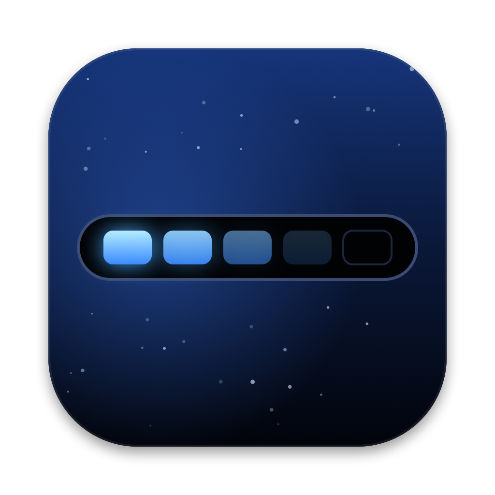
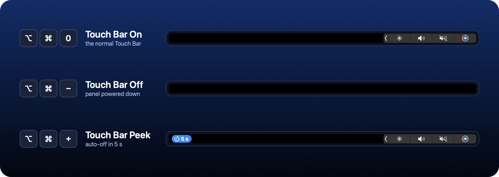
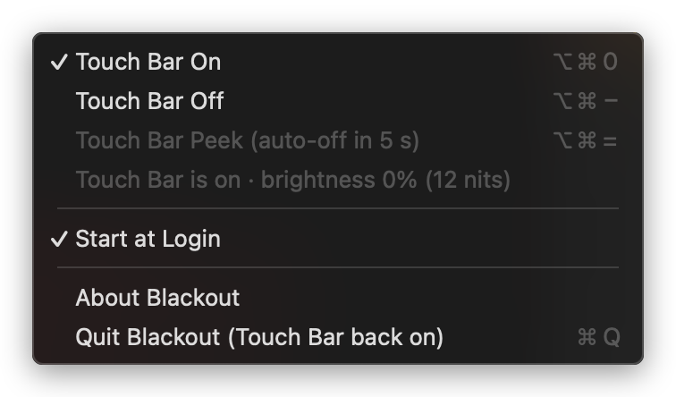

<p align="center">
  
</p>

<h1 align="center">Blackout</h1>

<p align="center"><b>Switch your MacBook Pro's Touch Bar off.</b><br>
A menu bar app for flashing and flickering Touch Bars.</p>

<p align="center"></p>

Blackout powers your Touch Bar's panel off: a fix for Touch Bars that flicker or flash bright white. When you need brightness, volume or mute, a shortcut brings the bar back for a few seconds.

## Why I built this

My 13-inch M1 MacBook Pro's Touch Bar started glitching. Every so often the whole bar would blink rapidly or flash bright white, which is blinding in a dim room. It didn't happen every day, and it usually happened when it was cold.

The common advice online, restarting the Touch Bar process, only helps for a while. My first attempt was an app that filled the bar with black, and the flashing came straight through it. The fault sits in the panel, after macOS has drawn the image, so no picture can hide it. So instead of hiding the flashing, I cut its power. Blackout switches the panel off the same way macOS does when the bar goes dark after you stop typing, and a panel with no power has nothing to flash. It turned out to work as a reset too: switching the bar off and back on once cleared a flashing episode completely.

That left one gap. Esc is a physical key on this model, but brightness, volume and mute live on the Touch Bar. A powered-off Touch Bar can't feel touches either (I tested it), so tapping it can't wake it. That's where the shortcuts come from: **⌥⌘-** to switch it off, **⌥⌘0** to switch it back on, and **⌥⌘+** to peek at it for a few seconds.

The real fix is a repair, usually a new top case. Blackout is for keeping the Mac comfortable to use until then, or instead.

## Features

- **Truly off:** the Touch Bar panel is powered down, not just showing black.
- **Stays off:** if macOS lights the bar again (a key press, waking from sleep, unlocking), Blackout switches it off within milliseconds.
- **Keyboard shortcuts that work from any app:**

  | Shortcut | Does |
  |---|---|
  | **⌥⌘0** | **Touch Bar On** |
  | **⌥⌘-** | **Touch Bar Off** |
  | **⌥⌘+** (or ⌥⌘=) | **Touch Bar Peek**: auto-off in 5 s. Use it for brightness, volume or mute while the bar is off. It waits while you're still adjusting. |

- **Menu bar icon:** click it to switch the bar on or off, or right-click it for the menu. The menu also shows the Touch Bar's current brightness.
- **Start at Login**, and an offer to move the app to Applications on first launch.
- **Safe to quit:** quitting always turns the Touch Bar back on. Blackout changes no system settings and needs no Accessibility or Input Monitoring permission.

<p align="center"></p>

## Requirements

- A MacBook Pro with a Touch Bar and Apple silicon:
  - 13-inch, M1, 2020 (`MacBookPro17,1`): **tested**
  - 13-inch, M2, 2022 (`Mac14,7`): should work, but untested
- macOS 15 (tested on 15.4.1). It's built for macOS 11 and later, but hasn't been tried on older versions.
- Intel Touch Bar MacBook Pros aren't supported yet.

## Install

1. Download **Blackout-1.0.0.zip** from [Releases](../../releases) and unzip it.
2. Open **Blackout**. It isn't notarized by Apple, so macOS blocks it the first time:
   - Open **System Settings → Privacy & Security**.
   - Scroll down to the message about Blackout and click **Open Anyway**, then confirm.
   - You only need to do this once.
3. When Blackout offers to move itself to Applications, click **Move to Applications**.
4. Look for the Touch Bar icon in the menu bar. Menu bar managers such as Bartender, Ice or Dozer may tuck new icons away.

You can also [build it yourself](#build-from-source).

## Use

| | |
|---|---|
| Turn the Touch Bar off | **⌥⌘-**, or click the menu bar icon |
| Brightness, volume or mute while it's off | **⌥⌘+** (Touch Bar Peek), then use the bar. It switches off after 5 s, or 3 s after your last change, whichever is later. Press **⌥⌘+** again for another 5 s. |
| Turn it back on | **⌥⌘0**, click the icon, or quit Blackout |
| Start at login | Right-click the icon → **Start at Login** |

Blackout starts with the Touch Bar on. A powered-off Touch Bar can't feel touches (see [How it works](#how-it-works)), so tapping a dark bar does nothing. Use **⌥⌘+**.

## How it works

Blackout uses private macOS frameworks, all looked up at runtime. If a macOS update removes something, the matching feature turns itself off rather than crashing the app.

- **Panel power:** `DFRBrightnessClient` (`DFRBrightness.framework`) `turnOffWithPeriod:` / `turnOnWithPeriod:` is the switch macOS itself uses when the Touch Bar goes dark after you stop typing. A zero period skips the fade, so the panel never lingers at the low brightness levels where faulty panels flicker most.
- **Keeping it off:** `DFRRegisterStatusChangeCallback` (`DFRFoundation.framework`) reports when macOS lights the panel, and Blackout switches it off again. A once-a-second check backs this up.
- **Black backup:** a full-width "system modal" Touch Bar (`+[NSTouchBar presentSystemModalTouchBar:…]`) containing only black. Anything that briefly lights the panel shows black, not buttons.
- **Shortcuts:** Carbon `RegisterEventHotKey`. macOS only tells the app when those exact key combinations are pressed, so no Accessibility or Input Monitoring permission is needed. Only these exact combinations are taken. Similar shortcuts without Option, such as Word's ⌘= / ⌘⇧= for subscript and superscript, still work.
- **Touch Bar Peek:** the bar stays lit for at least 5 s, and for 3 s after volume, mute or display brightness last *changed*. It doesn't watch input in general, because typing or a palm on the trackpad would keep it lit.
- **Brightness readout:** `BrightnessSystemClient` (`CoreBrightness.framework`), read only.

`Blackout touchtest` runs a guided 2-minute experiment with an on-screen window and spoken steps. It showed that **a powered-off panel's touch sensor is off too**: taps on the dark bar produced no events at all. That's why the bar is woken with a shortcut rather than a tap.

## Command line

```bash
B=/Applications/Blackout.app/Contents/MacOS/Blackout
$B status          # lit or dark, plus brightness
$B on | off        # switch the panel directly, e.g. if the app ever crashed while the bar was off
$B key off         # same as ⌥⌘- in the running app (also: key on, key peek)
$B login on | off  # Start at Login
$B touchtest       # does your Touch Bar feel touches while it's dark?
$B version
```

## Build from source

You need the Swift compiler from Xcode or the Xcode Command Line Tools.

```bash
git clone https://github.com/LeshawnG/blackout-touchbar-macos.git
cd blackout-touchbar-macos
./build.sh            # → build/Blackout.app
./build.sh release    # → dist/Blackout-<version>.zip
./build.sh icon       # redraw the app icon (tools/make_icon.swift)
```

There's no Xcode project: `build.sh` calls `swiftc` directly and signs the app ad hoc.

## Uninstall

1. Quit Blackout from its menu. The Touch Bar comes back on.
2. Untick **Start at Login** first, or delete `~/Library/LaunchAgents/io.github.LeshawnG.Blackout.plist`.
3. Move **Blackout** from Applications to the Trash.

## Limits

- **It hides the fault; it doesn't repair it.** A failing panel, cable or display controller is a hardware problem. The proper fix is a repair, usually a top-case replacement.
- **A brief flash is still possible** at login, right after waking, or in the instant before Blackout switches the panel off again.
- **Private APIs:** a macOS update could break things. If panel power control disappears, Blackout falls back to the black backup bar.
- **⌥⌘0 is taken while Blackout runs:** it overrides Xcode's "Show/Hide Inspectors" and VS Code's "Toggle Editor Group Layout".

## Credits

The panel power-off technique comes from [TouchBar Flicker Fix](https://github.com/sennamint/touchbar-flicker-fix) and Guillermo Pages' [touchbar-off](https://github.com/gbili/touchbar-off) (MIT). See [THIRD_PARTY_NOTICES.md](THIRD_PARTY_NOTICES.md).

## License

[MIT](LICENSE)
